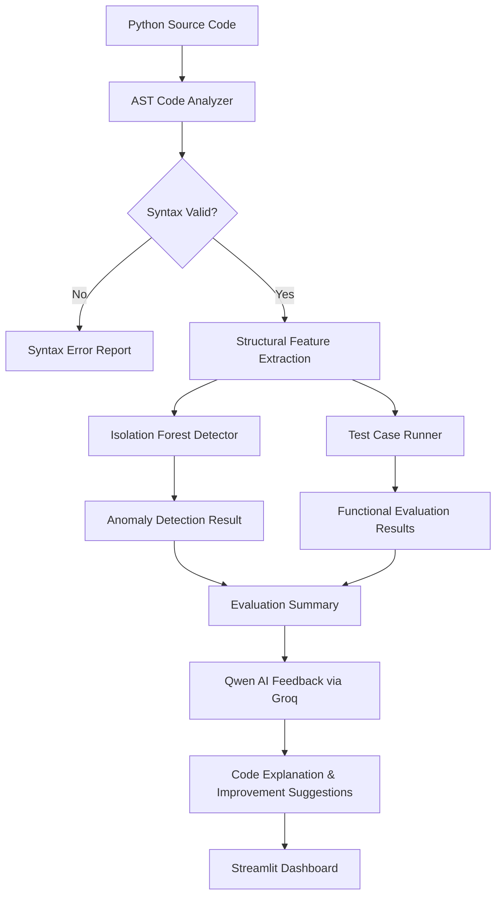

<h1 align="center">AI-Powered Python Code Evaluator</h1>

<h2>Overview</h2>

<p>
An AI-powered Python code evaluation system that combines <b>AST-based code analysis</b>, <b>test-case evaluation</b>, <b>machine learning-based anomaly detection</b>, and <b> LLM-generated feedback </b> to help users understand and improve their Python code.
</p>

<p>
This project has been developed as a proof of concept, taking inspiration from the functionalities and vision of <strong>Cynbit Studio</strong>, with a focus on AI-powered Python code evaluation, analysis, and personalized learning feedback.
</p>

<h2>Tech Stack</h2>

| Category | Tools |
|---|---|
| **Language & Dev** |     |
| **Data & ML** |     |
| **Notebooks & Viz** |    |
| **AI & LLM** |   |
| **Dashboard** |  |
| **Analysis & Testing** |    |
| **Utilities** |     |


## Project Structure

```text
AI-Powered-Python-Code-Evaluator/
│
├── AI Opportunity Report.pdf
├── README.md
├── app.py
├── requirements.txt
│
├── leetcode-dataset/
│   ├── LICENSE
│   ├── README.md
│   ├── data/
│   │   └── solutions.csv
│   └── dataset-metadata.json
│
├── notebooks/
│   ├── code_evaluator.ipynb
│   ├── leetcode_exploration.ipynb
│   └── model_training.ipynb
│
├── pipeline/
│   ├── __init__.py
│   ├── ai_feedback.py
│   ├── code_analyzer.py
│   ├── data_loader.py
│   ├── dataloader.py
│   ├── main.py
│   ├── ml_detector.py
│   ├── sandbox_runner.py
│   └── test_runner.py
│
└── reports/
    ├── anomaly_detection_results.csv
    ├── code_evaluation_results.csv
    ├── isolation_forest_model.joblib
    ├── leetcode_features.csv
    └── qwen_code_feedback.txt
```
## Pipeline Architecture


