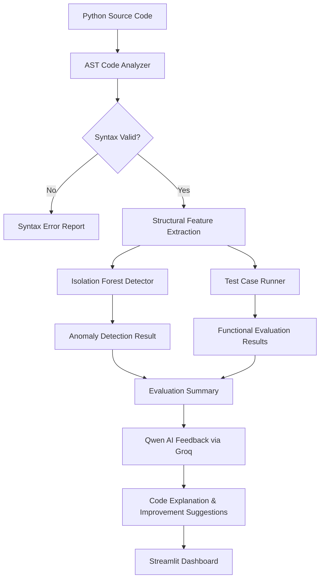

<h1 align="center">AI-Powered Python Code Evaluator</h1>

<h2>Overview</h2>

<p>
An AI-powered Python code evaluation system that combines <b>AST-based code analysis</b>, <b>test-case evaluation</b>, <b>machine learning-based anomaly detection</b>, and <b> LLM-generated feedback </b> to help users understand and improve their Python code.
</p>

<p>
This project has been developed as a proof of concept, taking inspiration from the functionalities and vision of <strong>Cynbit Studio</strong>, with a focus on AI-powered Python code evaluation, analysis, and personalized learning feedback.
</p>

<h2>Tech Stack</h2>

| Category | Tools |
|---|---|
| **Language & Dev** |     |
| **Data & ML** |     |
| **Notebooks & Viz** |    |
| **AI & LLM** |   |
| **Dashboard** |  |
| **Analysis & Testing** |    |
| **Utilities** |     |


## Project Structure

```text
AI-Powered-Python-Code-Evaluator/
│
├── AI Opportunity Report.pdf
├── README.md
├── app.py
├── requirements.txt
│
├── leetcode-dataset/
│   ├── LICENSE
│   ├── README.md
│   ├── data/
│   │   └── solutions.csv
│   └── dataset-metadata.json
│
├── notebooks/
│   ├── code_evaluator.ipynb
│   ├── leetcode_exploration.ipynb
│   └── model_training.ipynb
│
├── pipeline/
│   ├── __init__.py
│   ├── ai_feedback.py
│   ├── code_analyzer.py
│   ├── data_loader.py
│   ├── dataloader.py
│   ├── main.py
│   ├── ml_detector.py
│   ├── sandbox_runner.py
│   └── test_runner.py
│
└── reports/
    ├── anomaly_detection_results.csv
    ├── code_evaluation_results.csv
    ├── isolation_forest_model.joblib
    ├── leetcode_features.csv
    └── qwen_code_feedback.txt
```
## Pipeline Architecture



## Key Findings

### 1. Dataset Analysis
- Analyzed **2,314 Python solutions** from the LeetCode dataset.
- The dataset contained no missing values or duplicate records.
- All 2,314 Python solutions were successfully parsed using Python AST.
- Identified variations in code length, functions, loops, conditional statements, and function calls.

### 2. Feature Extraction
Extracted structural features from Python source code, including:

- Code length and number of lines.
- Number of functions and classes.
- Number of loops and conditional statements.
- Number of function calls and imports.

### 3. Anomaly Detection Results

The Isolation Forest model identified structurally unusual code samples.

| Result | Count |
|---|---:|
| Total code samples | 2,314 |
| Not flagged | 2,015 |
| Flagged as anomalies | 299 |
| Anomaly percentage | 12.92% |
| Not flagged percentage | 87.08% |

### 4. Structural Pattern Analysis

- Flagged samples had higher average code length and more structural elements than non-flagged samples.
- Anomalous samples showed higher average numbers of functions, loops, conditional statements, and function calls.
- Longer and structurally more complex solutions appeared more frequently among flagged samples.

### 5. Functional Evaluation

- Implemented test-case-based evaluation using predefined test cases.
- Tested the Two Sum example against five test cases.
- Achieved **5/5 passed test cases (100%)** in the example evaluation.

### 6. AI-Generated Feedback

- Integrated Qwen through the Groq API.
- Generated code explanations and improvement suggestions.
- Used actual test evaluation results as context for AI-generated feedback.
- Included beginner-friendly explanations and potential improvements.

## Installation and Setup

1. Clone the Repository

```text
git clone https://github.com/rahul15-manch/Cynbit-AIML-Intern-Assignment-.git

cd Cynbit-AIML-Intern-Assignment-
```
2. Create a Virtual Environment
```text
python -m venv venv
```
Activate it:  macOS / Linux
```text
source venv/bin/activate
```
Windows
```text
venv\Scripts\activate
```
3. Install Dependencies
```text
pip install -r requirements.txt
``` 

4. Configure the Groq API Key

Create a .env file in the project root:
```text 
GROQ_API_KEY=your_groq_api_key
```
<b>Keep your API key private. Do not commit .env to GitHub.</b>
## Running the Project

Option 1: Jupyter Notebooks
Start Jupyter Notebook:
```text
jupyter notebook
```
Explore the notebooks in the notebooks/ directory.

Option 2: Python Pipeline

Run the pipeline as a package from the project root:
```text 
python -m pipeline.main
```
The pipeline modules can also be imported into other Python scripts.

Option 3: Streamlit Dashboard

Run:
```text
streamlit run app.py
```
The dashboard will open in your browser.
